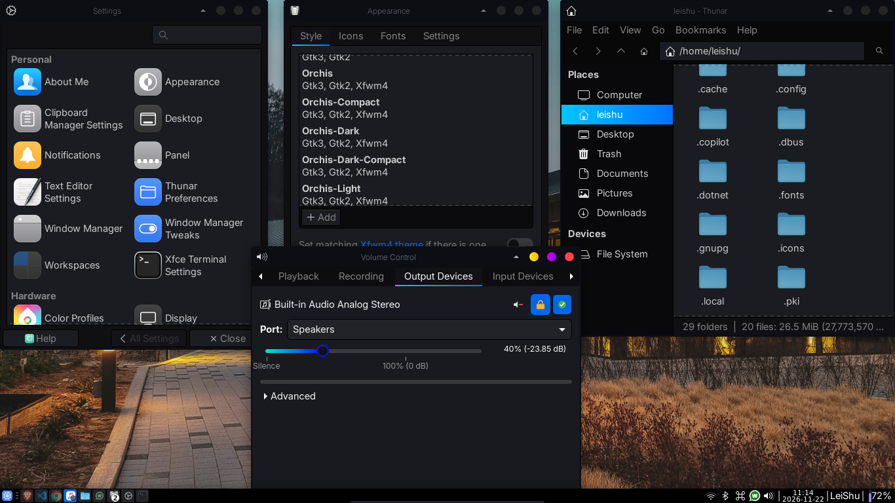

# How to Make Your XFCE Desktop look better/interesting

## Steps 

1. Download the materials which is : 
    - Font (https://fonts.google.com/specimen/Inter) 
    - Theme (https://www.gnome-look.org/p/1357889)
    - Second Theme (https://www.gnome-look.org/p/1253385)
    - Icon Theme (https://www.gnome-look.org/browse?cat=132&ord=rating)

    DISCLAIMER : ALL MATERIALS CAN ACCORDING OF YOUR PERSONAL FAVOURITE
2. After you download it you must extract the all file with click "Extract Here" at your desktop
3. And then you go to the home directory and click CTRL + H to show the hidden file and then make 3 folders with this name below :
    - ".fonts" (this is for your font)
    - ".icons" (this is for your icon theme)
    - ".themes" (this is for your desktop themes)
4. After that you must move the result of your extract to the each folder
    - Result of icons file move to .icons folder
    - Result of Font file move to .fonts folder
    - Result of all themes files move to .themes folder
5. After that , open the "Apperance menu on your desktop" and then apply it all 
    - Style is for the themes
    - Icons is for the icons
    - Fonts is for the font

    APPLY THE DESIGN ONE BY ONE TO FIND WHICH YOUR FAVOURITE DESIGN
6. Setting your taskbar with right click on the taskbar and then find "Panel Preferences" and setting according to your favourite

## The Result of My Customize
